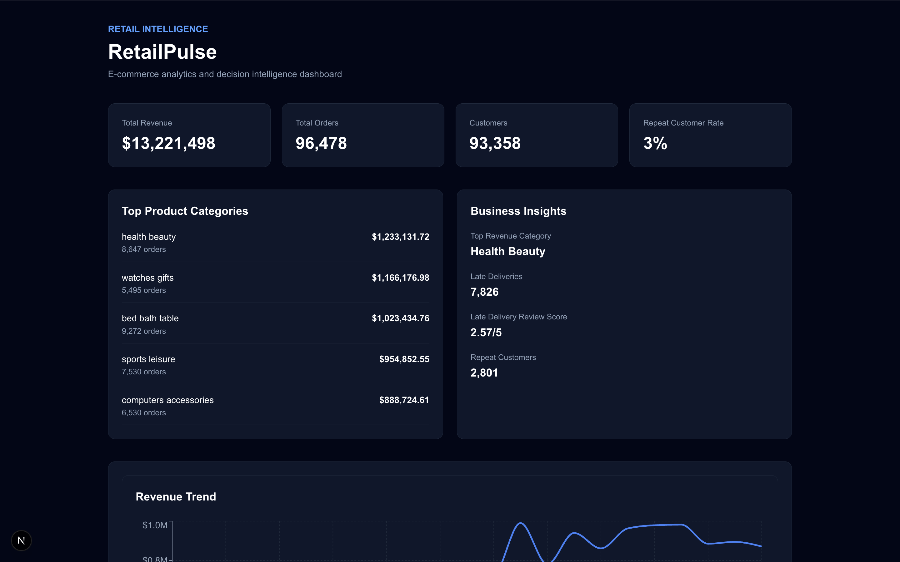

# RetailPulse

RetailPulse is an end-to-end retail analytics and decision intelligence platform that transforms raw e-commerce transaction data into business metrics, operational insights, and interactive visualizations.

The project combines data engineering, analytical SQL, backend API development, and full-stack visualization in a single application.

## Dashboard


## Current Capabilities

- Python-based ETL pipeline for ingesting and cleaning e-commerce data
- PostgreSQL relational data store
- Reusable SQL analytics views for business metrics
- Monthly revenue and growth analysis
- Product category performance analysis
- Customer and repeat-customer analysis
- Delivery performance and customer satisfaction analysis
- REST analytics API built with FastAPI
- Interactive dashboard built with Next.js, TypeScript, and Recharts

## Architecture

```text
Raw E-commerce Data
        |
        v
Python ETL Pipeline
        |
        v
PostgreSQL
        |
        v
Analytics SQL Views
        |
        v
FastAPI REST API
        |
        v
Next.js / TypeScript Dashboard
        |
        v
Business Metrics & Visualizations

Tech Stack
Data Engineering
- Python
- Pandas
- SQLAlchemy
Database & Analytics
- PostgreSQL
- SQL
Backend
- FastAPI
- Uvicorn
Frontend
- Next.js
- TypeScript
- React
- Recharts
- Tailwind CSS
Analytics
RetailPulse currently analyzes:
- Total and monthly revenue
- Month-over-month revenue growth
- Order volume
- Average order value
- Top-performing product categories
- Customer counts
- Repeat-customer behavior
- Delivery timeliness
- Relationship between delivery performance and customer review scores
API
The FastAPI backend exposes analytics through REST endpoints:
Endpoint	Description
GET /health	API health check
GET /api/analytics/revenue	Monthly revenue and growth metrics
GET /api/analytics/categories	Product category performance
GET /api/analytics/customers	Customer and repeat-customer metrics
GET /api/analytics/delivery	Delivery performance and review metrics


Interactive API documentation is available through FastAPI's Swagger UI when the backend is running.
Dataset
RetailPulse uses the public Brazilian E-Commerce dataset by Olist.
The raw dataset is intentionally excluded from this repository. The ETL pipeline loads the required CSV files into PostgreSQL after they are downloaded locally.
Project Structure
retailpulse/
├── app/                # FastAPI backend
│   └── routes/         # Analytics API routes
├── dashboard/          # Next.js dashboard
├── pipelines/          # Python ETL and data profiling
├── sql/                # Schema and analytical SQL
├── requirements.txt
└── README.md

Roadmap
RetailPulse is being extended from descriptive analytics into a decision intelligence platform.
Planned capabilities include:
- Automated anomaly detection
- Root-cause analysis
- Revenue forecasting and backtesting
- Evidence-based recommendation engine
- What-if business simulation
- Grounded natural-language analytics copilot
Status
The core analytics platform is complete. Advanced decision intelligence capabilities are under active development.